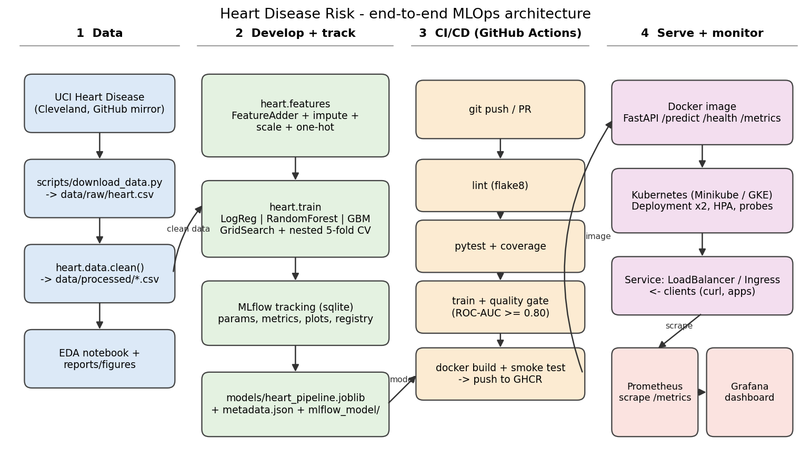

# Heart Disease Risk - End-to-End MLOps Project

Predict the presence of heart disease from 13 clinical features and serve the model as a
containerised, monitored REST API (MLOps Assignment 01, BITS Pilani).



| Stage | Where |
|---|---|
| Data download / cleaning / EDA | `scripts/download_data.py`, `src/heart/data.py`, `src/heart/eda.py`, `notebooks/01_eda.ipynb` |
| Features + models + tuning | `src/heart/features.py`, `src/heart/train.py`, `notebooks/02_model_training.ipynb` |
| Experiment tracking | MLflow (`mlflow.db`, experiment `heart-disease-risk`) |
| Packaged model | `models/heart_pipeline.joblib`, `models/metadata.json`, `models/mlflow_model/` |
| Inference | `src/heart/predict.py`, `notebooks/03_inference.ipynb`, API `src/heart/api.py` |
| Tests | `tests/` (38 tests) |
| CI/CD | `.github/workflows/ci.yml` |
| Container | `Dockerfile`, `docker-compose.yml` |
| Kubernetes | `k8s/` |
| Monitoring | `monitoring/` (Prometheus + Grafana), JSON logs in `logs/api.log` |
| Report | `docs/Heart_Disease_MLOps_Report.pdf` |

## 1. Setup (clean machine)

```bash
python3 -m venv .venv && source .venv/bin/activate     # Python 3.12
pip install -r requirements-dev.txt
export PYTHONPATH=src                                    # Windows PowerShell: $env:PYTHONPATH="src"

python scripts/download_data.py      # -> data/raw/heart.csv   (a copy is already committed)
python -m heart.data                 # -> data/processed/heart_clean.csv
python -m heart.eda                  # -> reports/figures/*.png
python -m heart.train                # tune + evaluate + log to MLflow + save models/  (~3 min on 1 CPU)
pytest --cov=src/heart               # 38 tests
flake8 src tests scripts
```
`make data train test lint` does the same. Browse experiments: `make mlflow-ui` (http://localhost:5000).

### Data
The assignment source is the UCI *Heart Disease* dataset (Cleveland subset, 303 patients).
`download_data.py` fetches the widely used 14-column CSV of that data from GitHub mirrors. If you prefer the
official file (https://archive.ics.uci.edu/dataset/45/heart+disease, `processed.cleveland.data`), note it uses a
different coding (cp 1-4, thal 3/6/7, `?` for missing, `num` 0-4) and would need a mapping to the schema in
`src/heart/config.py`. Two facts about the mirror, both handled in `heart.data.clean()`:
* `target` is inverted (1 = *no* disease). Verified: target 1 has higher max heart rate and less angina, and the
  counts match UCI (164 healthy / 139 diseased). The cleaner flips it so **1 = disease**.
* `ca = 4` and `thal = 0` are invalid placeholders and are treated as missing (4 + 2 rows, like UCI's missing values).

## 2. Results (hold-out test set of 61 patients; nested 5-fold CV on the other 241)

| Model | CV ROC-AUC | CV accuracy | CV recall | Test ROC-AUC | Test accuracy | Test recall |
|---|---|---|---|---|---|---|
| **Logistic regression (selected)** | 0.907 +/- 0.039 | 0.846 | 0.809 | 0.918 | 0.836 | 0.786 |
| Random forest | 0.910 +/- 0.036 | 0.830 | 0.791 | 0.894 | 0.787 | 0.679 |
| Gradient boosting | 0.900 +/- 0.030 | 0.830 | 0.809 | 0.879 | 0.770 | 0.643 |

CV scores are statistically tied, so the **one-standard-error rule** (CV only, never the test set) picks the
simplest model within one SD of the best. With 61 test patients the test numbers carry wide uncertainty.

## 3. Run the API

```bash
uvicorn heart.api:app --port 8000                      # local
docker build -t heart-disease-api:1.0.0 . && docker run --rm -p 8000:8000 heart-disease-api:1.0.0
bash scripts/demo_api.sh                               # health + 2 predictions + 1 invalid request
```
Docs UI: http://localhost:8000/docs . Example:
```bash
curl -X POST localhost:8000/predict -H 'Content-Type: application/json' -d '{"age":63,"sex":1,"cp":3,"trestbps":145,"chol":233,"fbs":1,"restecg":0,"thalach":150,"exang":0,"oldpeak":2.3,"slope":0,"ca":0,"thal":1}'
# {"prediction":..., "label":..., "confidence":..., "probability_disease":..., "model_version":...}
```
`ca` and `thal` are optional (imputed). Input ranges are validated (invalid -> HTTP 422).
**Educational project, not a medical device.**

## 4. Monitoring (Docker Compose)
```bash
docker compose up --build        # API :8000, Prometheus :9090, Grafana :3000 (admin / admin)
bash scripts/traffic.sh localhost:8000 200
```
Grafana auto-loads the "Heart Disease API" dashboard (request rate, p95 latency, predictions by class, errors,
median confidence). Request logs are JSON lines (`request_id`, status, latency); patient payloads are not logged.

## 5. Kubernetes (Minikube or Docker Desktop)
```bash
docker build -t heart-disease-api:1.0.0 .
minikube image load heart-disease-api:1.0.0              # Docker Desktop: skip
kubectl apply -k k8s/
kubectl -n heart-api get pods,svc
minikube tunnel                                          # in a second terminal (LoadBalancer)
bash scripts/demo_api.sh http://<EXTERNAL-IP>            # or http://localhost with Docker Desktop
```
Cloud (GKE/EKS/AKS): push the image (CI already publishes `ghcr.io/<user>/heart-disease-api`), change `image:` in
`k8s/deployment.yaml`, apply the same manifests. `k8s/ingress.yaml` is an optional Ingress alternative.

**Deployed URL:** _not deployed publicly - use the local access instructions above._

## 6. CI/CD (`.github/workflows/ci.yml`)
lint (flake8) -> unit tests + coverage (artifacts) -> train + quality gate (hold-out ROC-AUC >= 0.80; artifacts)
-> docker build + container smoke test -> push to GHCR (main only). Any failing step fails the run.

## 7. Layout
```
src/heart/      config, data, features, train, predict, eda, api
scripts/        download_data.py, demo_api.sh, traffic.sh, make_terminal_images.py
tests/          data, features, model, api, download, eda
notebooks/      01_eda, 02_model_training, 03_inference (+ build_notebooks.py)
k8s/ monitoring/ Dockerfile docker-compose.yml .github/workflows/ci.yml
models/ data/ reports/figures/ screenshots/ docs/ logs/
```
